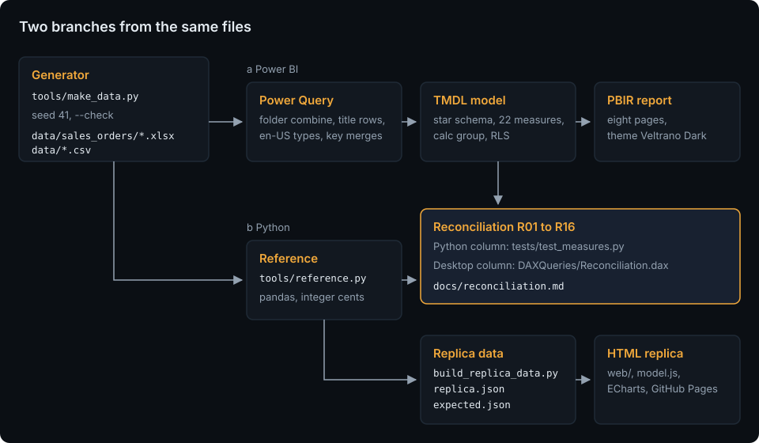

# Sales Performance Dashboard

[](https://github.com/HARISPAARTAN/sales-performance-dashboard/actions/workflows/ci.yml)
[](https://github.com/HARISPAARTAN/sales-performance-dashboard/actions/workflows/pages.yml)
[](https://github.com/HARISPAARTAN/sales-performance-dashboard/releases)

Power-BI-Vertriebsdashboard für einen fiktiven Outdoor-Großhändler: ein Sternschema in TMDL mit einer Berechnungsgruppe für Zeitvergleiche, einem Feldparameter und dynamischer Sicherheit auf Zeilenebene, jede Kennzahl im Kopf der Seiten gegen eine unabhängige Python-Berechnung abgeglichen, dazu eine HTML-Nachbildung als Live-Demo.

English: [README.md](README.md)

## Status

- Die Datendateien entsprechen einem frischen Lauf von `tools/make_data.py`, und die Offline-Prüfungen von Modell und Bericht bestehen (`uv run pytest`).
- Noch nicht in Power BI Desktop geöffnet.
- Noch kein Release.

## Kundenauftrag

> Wir sind ein Großhändler für Outdoor-Ausrüstung in Innsbruck und verkaufen Zelte, Schlafsäcke und Matten, Rucksäcke, Bekleidung, Schuhe und Kochausrüstung an rund 400 Fachgeschäfte in Europa. Jeden Monat exportieren wir die Auftragspositionen aus dem ERP nach Excel, und der Vertrieb führt monatliche Umsatzziele je Region in einer CSV-Datei. Wir möchten auf diesen beiden Quellen ein interaktives Power-BI-Dashboard: Umsatz und Marge, die monatliche Entwicklung gegenüber dem Vorjahr, welche Produkte das Geschäft tragen, wie jede Region verkauft und wo wir gegenüber dem Ziel stehen. Unsere Regionalleitungen sollen nur ihre eigenen Regionen sehen.

Rebuilt from memory as a demo. The original client's name and data are not used. (Aus dem Gedächtnis als Demo nachgebaut; Name und Daten des ursprünglichen Kundenunternehmens werden nicht verwendet.) Veltrano Outdoor ist ein fiktives Unternehmen; Nutzende, Umfang und Abnahmekriterien stehen in [docs/brief.md](docs/brief.md).

## Live-Demo

[harispaartan.github.io/sales-performance-dashboard](https://harispaartan.github.io/sales-performance-dashboard/)

Die Nachbildung ist eine statische Seite mit den sechs Berichtsseiten als Reitern (Overview, Trends, Products, Regions, Customers, Targets), denselben Filtern (Jahr, Monate, Region, Kategorie, Kreuzfilter per Klick auf einen Balken) und denselben Regeln wie der Bericht, gezeichnet mit ECharts aus ganzzahligen Würfeln, die die Python-Referenz erzeugt. Sie läuft im Browser ohne Server und sendet keine Daten; die Filter bleiben nur in diesem Browser gespeichert. Nicht enthalten sind die Sicherheit auf Zeilenebene, die Seite Info (der Dialog About ersetzt sie) und das Diagramm nach Vertriebsmitarbeitenden.

## Was es kann

Acht Berichtsseiten auf einer Fläche von 1280 × 720 im Design Veltrano Dark: eine Kopfzeile mit dem Datenstand, eine Slicer-Zeile (Year, Months, Region, Category, Reset), die über die Seiten synchronisiert ist, eine Reihe Kennzahlkacheln mit der Veränderung zum Vorjahr und darunter die Diagramme.

- **Overview**: Umsatz, Bruttomarge in %, Aufträge, durchschnittlicher Auftragswert und Rabatt in %; der Monatsverlauf gegenüber dem Vorjahr; Umsatz und Marge je Monat; Umsatz nach einer wählbaren Dimension (Analyse by: Kategorie, Region, Segment oder Kanal).
- **Trends**: seit Jahresbeginn, Vorjahr bis zum selben Monat, rollierende 12 Monate und Stückzahlen; Stückzahlen nach Kategorie; eine Matrix mit allen sieben Zeitberechnungen je Monat.
- **Products**: ein Pareto-Diagramm der 40 umsatzstärksten Produkte mit dem kumulierten Anteil, eine Produkttabelle mit Rang und ABC-Klasse und der Umsatz nach Kategorie mit Drill-down auf Unterkategorien; eine Tooltip-Seite je Produkt.
- **Regions**: Umsatz nach Region gegenüber dem Vorjahr, nach Monat und Region, eine Ländermatrix sowie Rabatt gegen Marge je Land.
- **Customers**: Umsatz nach Segment und nach Vertriebsmitarbeitenden sowie die Kundentabelle.
- **Targets**: Umsatz gegen Ziel je Monat, Zielerreichung je Region (ok oder Warnung gegenüber 100 %) und eine Matrix Region × Monat.
- **Info**: was die Demo ist, ihre Quellen, das Modell und der Zeitraum.

Regionalleitungen sehen nur ihre Regionen: Die Rolle `Regional manager` filtert über die Anmeldeadresse und die Tabelle `Security`; eine neue Regionalleitung ist eine neue Zeile in `data/security.csv`, keine Modelländerung.

## So funktioniert es



Der Generator mit festem Startwert schreibt die Dateien des Kunden: drei Jahresarbeitsmappen mit Auftragspositionen und sechs CSV-Dateien. Power Query im Power-BI-Projekt kombiniert die Arbeitsmappen, überspringt die Titelzeilen und typisiert jede Spalte mit der Kultur en-US; Modell und Bericht liegen als Text vor (TMDL und PBIR). Unabhängig davon berechnet `tools/reference.py` jede Kennzahl mit pandas in ganzen Cent. Beide treffen sich im [Abgleich](docs/reconciliation.md): Sechzehn Kennzahlen aus Python und aus Power BI Desktop müssen übereinstimmen. Dieselbe Referenz erzeugt die Daten der Nachbildung. Mehr in [docs/architecture.md](docs/architecture.md).

## Datenmodell

Ein Sternschema: `FactSales` (Auftragspositionen) und `FactTargets` (Region × Monat) mit `DimDate`, `DimProduct`, `DimCustomer`, `DimRegion` und `DimSalesRep`; 22 Kennzahlen in `_Measures`; die Berechnungsgruppe `Time intelligence` (Current, PY, YoY, YoY %, YTD, PYTD, R12) auf Fenstern über den Monatsindex, sodass das angebrochene Jahr 2025 Januar bis September mit denselben Monaten 2024 vergleicht; der Feldparameter `Analyse by`; die verborgene Tabelle `Security` für die Sicherheit auf Zeilenebene. Tabellen, Spalten und die Regeln des Generators stehen in [docs/data-model.md](docs/data-model.md), jede Kennzahl mit ihrem DAX in [docs/measures.md](docs/measures.md).

## Erste Schritte

Benötigt Python 3.13 mit [uv](https://docs.astral.sh/uv/), Power BI Desktop unter Windows für den Bericht und Node 22 für die Tests der Nachbildung.

```bash
git clone https://github.com/HARISPAARTAN/sales-performance-dashboard.git
cd sales-performance-dashboard
uv sync
uv run python tools/make_data.py --check      # die Daten entsprechen einem frischen Lauf
uv run pytest -q                               # Python-Tests, Referenz und Offline-Prüfungen des PBIP
node --test "tests/replica/*.test.mjs"         # Filter- und Diagrammcode der Nachbildung
```

`pbip/SalesPerformance.pbip` in Power BI Desktop öffnen. Start, Daten transformieren, Parameter bearbeiten: `DataFolder` auf den Ordner `data` des eigenen Klons setzen, mit abschließendem Backslash (Vorgabe `E:\GITGUB\sales-performance-dashboard\data\`), übernehmen, dann Aktualisieren. Die DAX-Abfrageansicht enthält die gespeicherte Abfrage `Reconciliation`.

Die Nachbildung lokal mit `uv run python -m http.server -d web 8000` ausliefern und http://127.0.0.1:8000/ öffnen. Aktualisieren, neue Daten, Ziele und Regionalleitungen: [docs/handover.md](docs/handover.md).

## Projektstruktur

```text
data/                erzeugte Datendateien: sales_orders/ (drei Arbeitsmappen) und sechs CSV-Dateien
pbip/                das Power-BI-Projekt: SalesPerformance.pbip, .SemanticModel (TMDL, DAXQueries), .Report (PBIR, Design)
tools/               make_data.py, reference.py, build_replica_data.py, sync_kit.py, check_page_weight.py, pbi/, checks/
web/                 die Nachbildung: index.html, assets/ (css, js, data), kit/, vendor/ (ECharts)
tests/               Python-Tests, pbi/ (Offline-Prüfungen des PBIP), replica/ (node --test), fixtures/mini/
docs/                Auftrag, Datenmodell, Kennzahlen, Architektur, adr/, Übergabe, Desktop-Sitzung, Abgleich, screenshots/
.github/             ci.yml, pages.yml, dependabot.yml
```

## Entscheidungen

- [ADR 0001: Jahresarbeitsmappen, aus einem Ordner kombiniert](docs/adr/0001-yearly-order-workbooks.md)
- [ADR 0002: Eine unabhängige pandas-Referenz in ganzen Cent](docs/adr/0002-pandas-reference.md)
- [ADR 0003: Zeitvergleiche auf Fenstern über den Monatsindex](docs/adr/0003-month-index-time-intelligence.md)
- [ADR 0004: Dynamische Sicherheit auf Zeilenebene über eine getrennte Tabelle](docs/adr/0004-dynamic-rls.md)
- [ADR 0005: Die Nachbildung rechnet auf spaltenweisen ganzzahligen Würfeln](docs/adr/0005-replica-cubes.md)

Die Entscheidungsdokumente sind auf Englisch.

## Im Vergleich zur ursprünglichen Lieferung

Dieser Nachbau ergänzt:

- einen schriftlichen Auftrag mit Nutzenden, Umfang und Abnahmekriterien sowie ein dokumentiertes Datenmodell;
- Modell und Bericht als prüfbaren Text (TMDL und PBIR) mit Offline-Lint-Tests und Schemaprüfungen;
- den Abgleich jeder Kennzahl im Kopf der Seiten gegen eine unabhängige pandas-Berechnung, auch des Umsatzes unter der Rolle für zwei Regionalleitungen;
- geprüfte Sicherheit auf Zeilenebene und ein Skript für die rollenfreie Kopie, die Publish to web braucht;
- Übergabenotizen zum Aktualisieren, zum Export eines neuen Jahres, zu Zielen und zu neuen Regionalleitungen;
- CI mit `uv sync --locked` und festgelegten Actions sowie eine Live-Nachbildung mit getestetem Filtercode.

## Lizenz und Hinweis zu den Daten

MIT, siehe [LICENSE](LICENSE). Alle Zahlen, Kundenkonten, Produkte und Personen in diesem Repository erfindet `tools/make_data.py`. Die Visual-Vorlagen in `tools/pbi/templates/` stammen aus microsoft/fabric-toolbox und die Schemas in `tools/pbi/schemas/` aus microsoft/json-schemas, beide MIT mit erhaltenen Lizenzen; ECharts 5.6.0 steht unter Apache-2.0 (`web/vendor/LICENSE-echarts.txt`); die Schriften in `web/kit/fonts/` stehen unter der SIL Open Font License.

Rebuilt from memory as a demo. The original client's name and data are not used.
