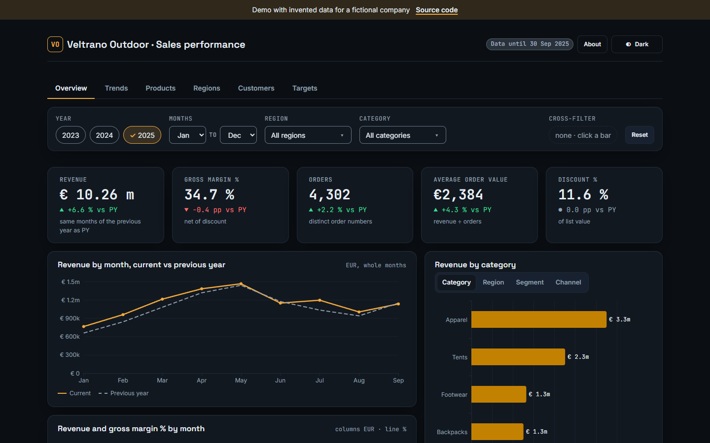
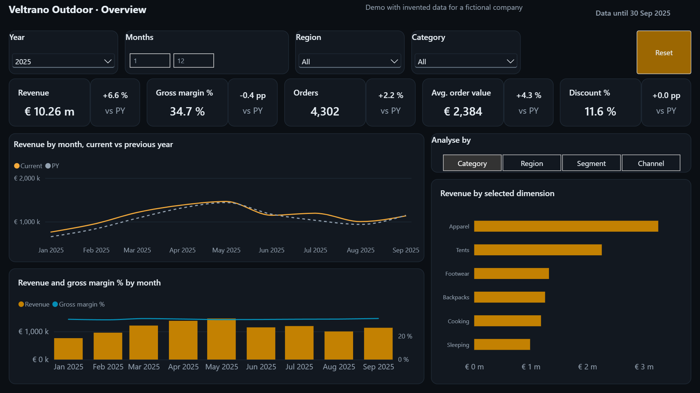
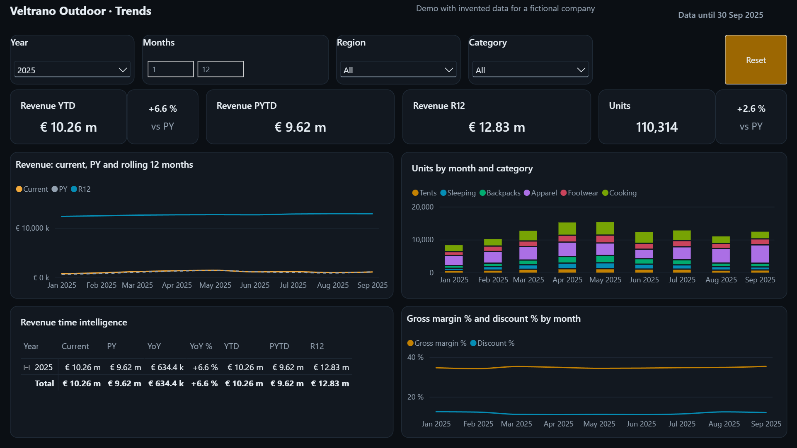
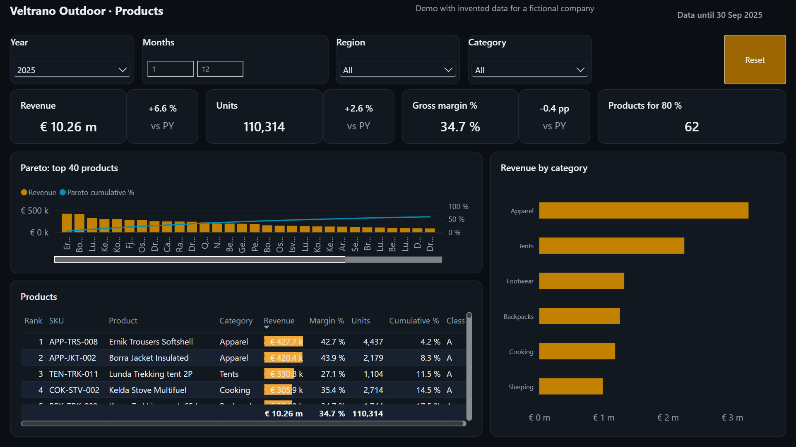
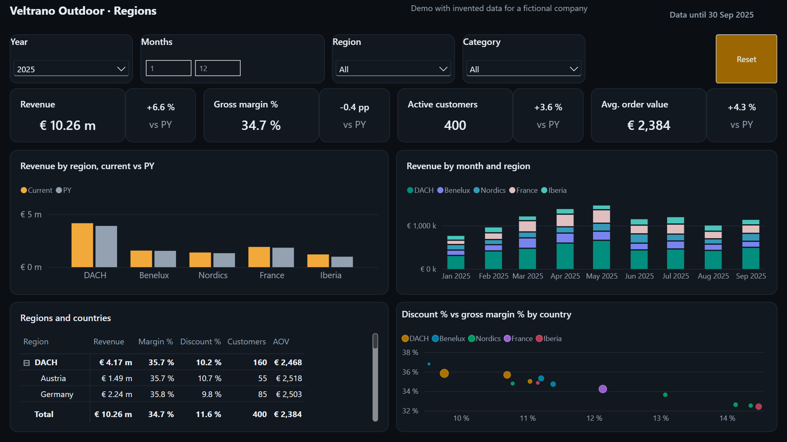
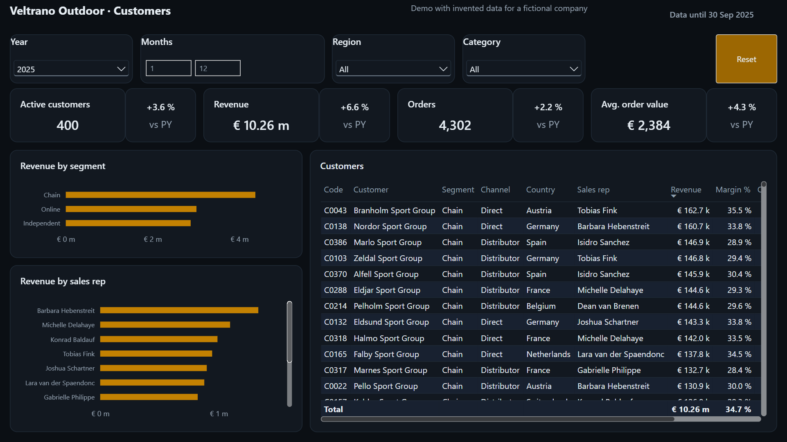
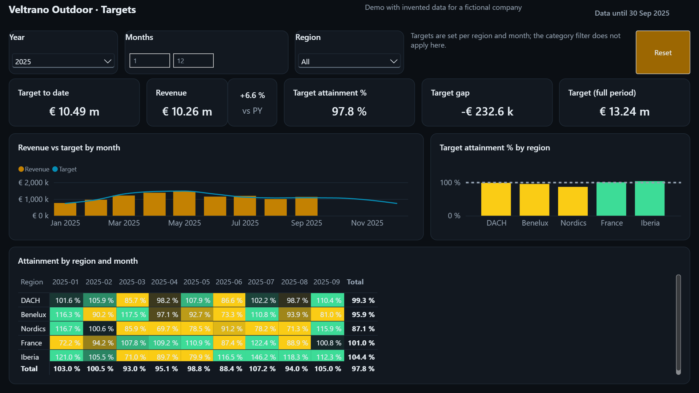
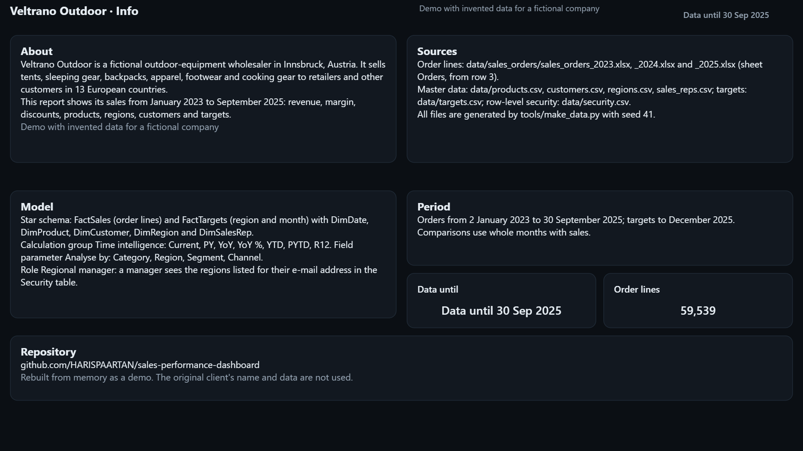
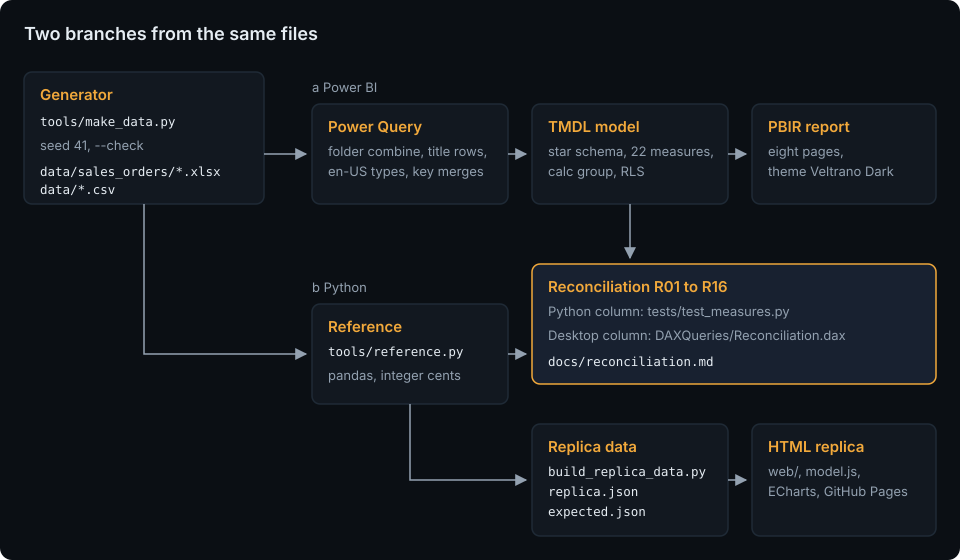
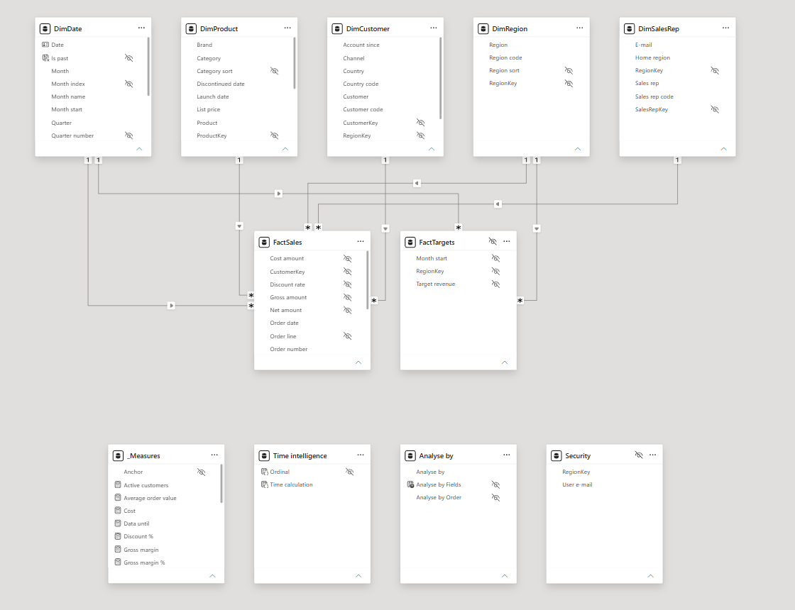

# Sales Performance Dashboard

[](https://github.com/HARISPAARTAN/sales-performance-dashboard/actions/workflows/ci.yml)
[](https://github.com/HARISPAARTAN/sales-performance-dashboard/actions/workflows/pages.yml)
[](https://github.com/HARISPAARTAN/sales-performance-dashboard/releases)

Power BI sales dashboard for a fictional outdoor-equipment wholesaler: a star schema in TMDL with a time-intelligence calculation group, a field parameter and dynamic row-level security, the sixteen headline checks reconciled against an independent Python computation, and a live HTML replica.

Deutsch: [README.de.md](README.de.md)

## Status

- The data files equal a fresh build of `tools/make_data.py`, and the offline checks of the model and the report pass (`uv run pytest`).
- Validated in Power BI Desktop 2.159.883.0 on 2026-10-30: the model refreshes from the files in `data/`, every page renders without an error, and all 16 reconciliation checks match the pandas reference, two of them under the role `Regional manager` ([reconciliation](docs/reconciliation.md)).
- Not released yet.

## Client brief

> We are an outdoor-equipment wholesaler in Innsbruck and sell tents, sleeping gear, backpacks, apparel, footwear and cooking gear to about 400 retailers in Europe. Each month we export our order lines from the ERP to Excel, and sales keeps monthly revenue targets per region in a CSV file. We want an interactive Power BI dashboard on these two sources: revenue and margin, the monthly trend against last year, which products carry the business, how each region sells and where we stand against target. Our regional managers should see only their own regions.

Rebuilt from memory as a demo. The original client's name and data are not used. Veltrano Outdoor is a fictional company; users, scope and acceptance criteria are in [docs/brief.md](docs/brief.md).

## Live demo

[harispaartan.github.io/sales-performance-dashboard](https://harispaartan.github.io/sales-performance-dashboard/)



The replica is a static page with the six report pages as tabs (Overview, Trends, Products, Regions, Customers, Targets), the same filters (year, months, region, category, cross-filter by a click on a bar) and the same rules as the report, drawn with ECharts from integer cubes that the Python reference builds. It runs in the browser without a server and sends no data anywhere; your filters stay in this browser only. It leaves out row-level security, the Info page (the About dialog replaces it), the segment and sales-rep charts, the margin and discount chart of Trends, and the category filter on Customers.

## What it does

Eight report pages (seven on a 1280 × 720 canvas, the product tooltip on 320 × 240) with the theme Veltrano Dark: a header with the data date, a slicer row (Year, Months, Region, Category, Reset) synced across the pages, a row of KPI tiles with the change against the previous year, and the charts below.

- **Overview**: revenue, gross margin %, orders, average order value and discount %; the monthly trend against the previous year; revenue and margin by month; revenue by a dimension you choose (Analyse by: category, region, segment or channel).
- **Trends**: year to date, previous year to date, rolling 12 months and units; units by category; a matrix with all seven time calculations by month.
- **Products**: a Pareto chart of the top 40 products with the cumulative share, a product table with rank and ABC class, and revenue by category with a drill to subcategories; a tooltip page per product.
- **Regions**: revenue by region against the previous year, by month and region, a country matrix and discount against margin by country.
- **Customers**: revenue by segment and by sales rep, and the customer table.
- **Targets**: revenue against target by month, attainment by region (ok or warning against 100 %) and a region × month attainment matrix.
- **Info**: what the demo is, its sources, the model and the period.

| Overview | Trends |
|---|---|
|  |  |

| Products | Regions |
|---|---|
|  |  |

| Customers | Targets |
|---|---|
|  |  |



Regional managers see only their regions: the role `Regional manager` filters by the sign-in address through the table `Security`, so a new manager is a new row in `data/security.csv`, not a model change.

## How it works



The seeded generator writes the client's files: three yearly order workbooks and six CSV files. Power Query in the Power BI project combines the workbooks, skips the title rows and types every column with the en-US culture; the model and the report are plain text (TMDL and PBIR). Independently, `tools/reference.py` computes every measure with pandas in integer cents. The two meet in [the reconciliation](docs/reconciliation.md): sixteen headline numbers from Python and from Power BI Desktop must match. The same reference builds the replica's data. More in [docs/architecture.md](docs/architecture.md).

## Data model



A star schema: `FactSales` (order lines) and `FactTargets` (region × month) with `DimDate`, `DimProduct`, `DimCustomer`, `DimRegion` and `DimSalesRep`; 22 measures in `_Measures`; the calculation group `Time intelligence` (Current, PY, YoY, YoY %, YTD, PYTD, R12) on month-index windows, so the partial year 2025 compares January to September with the same months of 2024; the field parameter `Analyse by`; the hidden table `Security` for row-level security. Tables, columns and the generator rules are in [docs/data-model.md](docs/data-model.md), every measure with its DAX in [docs/measures.md](docs/measures.md).

## Getting started

Needs Python 3.13 with [uv](https://docs.astral.sh/uv/), Power BI Desktop on Windows for the report, and Node 22 for the replica tests.

```bash
git clone https://github.com/HARISPAARTAN/sales-performance-dashboard.git
cd sales-performance-dashboard
uv sync
uv run python tools/make_data.py --check      # the committed data equal a fresh build
uv run pytest -q                               # Python tests, the reference and the offline checks of the PBIP
node --test "tests/replica/*.test.mjs"         # the replica's filter and chart code
```

Open `pbip/SalesPerformance.pbip` in Power BI Desktop. Home, Transform data, Edit parameters: set `DataFolder` to the `data` folder of your clone with a trailing backslash (the default is `E:\GITGUB\sales-performance-dashboard\data\`), apply, then Refresh. The DAX query view has the saved query `Reconciliation`.

Serve the replica locally with `uv run python -m http.server -d web 8000` and open http://127.0.0.1:8000/. Refreshing, new data, targets and managers: [docs/handover.md](docs/handover.md).

## Project layout

```text
data/                generated data files: sales_orders/ (three workbooks) and six CSV files
pbip/                the Power BI project: SalesPerformance.pbip, .SemanticModel (TMDL, DAXQueries), .Report (PBIR, theme)
tools/               make_data.py, reference.py, build_replica_data.py, sync_kit.py, check_page_weight.py, pbi/, checks/
web/                 the replica: index.html, assets/ (css, js, data), kit/, vendor/ (ECharts)
tests/               Python tests, pbi/ (offline checks of the PBIP), replica/ (node --test), fixtures/mini/
docs/                brief, data model, measures, architecture, adr/, handover, desktop session, reconciliation, screenshots/
.github/             ci.yml, pages.yml, dependabot.yml
```

## Decisions

- [ADR 0001: Yearly order workbooks combined from a folder](docs/adr/0001-yearly-order-workbooks.md)
- [ADR 0002: An independent pandas reference in integer cents](docs/adr/0002-pandas-reference.md)
- [ADR 0003: Time intelligence on month-index windows](docs/adr/0003-month-index-time-intelligence.md)
- [ADR 0004: Dynamic row-level security through a disconnected table](docs/adr/0004-dynamic-rls.md)
- [ADR 0005: The replica runs on columnar integer cubes](docs/adr/0005-replica-cubes.md)

## Compared with the original delivery

This rebuild adds:

- a written brief with users, scope and acceptance criteria, and a documented data model;
- the model and the report as reviewable text (TMDL and PBIR) with offline lint tests and schema checks;
- sixteen headline checks reconciled against an independent pandas computation, including revenue under the role for two managers;
- row-level security that is checked, and a script for the role-free copy that Publish to web needs;
- handover notes for refreshing, a new year's export, targets and new managers;
- CI with `uv sync --locked` and pinned actions, and a live replica with tested filter code.

## Licence and data note

MIT, see [LICENSE](LICENSE). Every number, customer, product and person in the data is invented by `tools/make_data.py`. The visual templates in `tools/pbi/templates/` come from microsoft/fabric-toolbox and the schemas in `tools/pbi/schemas/` from microsoft/json-schemas, both MIT with their licences kept; ECharts 5.6.0 is Apache-2.0 (`web/vendor/LICENSE-echarts.txt`); the fonts in `web/kit/fonts/` are under the SIL Open Font License.

Rebuilt from memory as a demo. The original client's name and data are not used.
