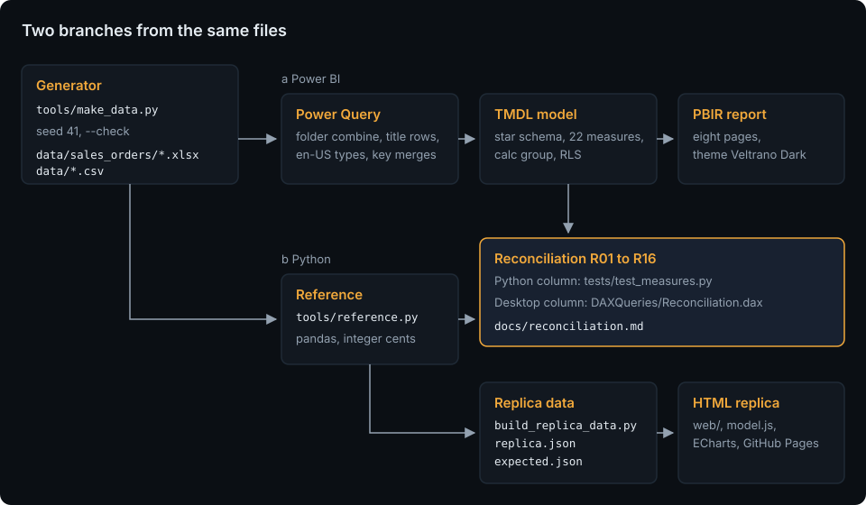

# Architecture

The seeded generator writes the files the client would have: three yearly order workbooks and six CSV files. Two branches read them independently:

- **a, Power BI:** Power Query in the PBIP combines the workbooks from the folder, skips the two title rows, converts types with culture en-US and turns the codes into integer keys; the TMDL model holds the star schema, the 22 measures, the calculation group `Time intelligence`, the field parameter `Analyse by` and the role `Regional manager`; the PBIR report shows eight pages with the theme `Veltrano Dark`.
- **b, Python:** `tools/reference.py` reads the same files with pandas and computes every measure and calculation item in integer cents. `tests/test_measures.py` checks the Python column of the reconciliation table against it; `tools/build_replica_data.py` turns it into `web/assets/data/replica.json` and the twelve expected filter states in `tests/replica/expected.json`.

The branches meet in [the reconciliation table](reconciliation.md): sixteen headline numbers, computed by Python and read from Power BI Desktop (the saved DAX query `Reconciliation` and View as for the role), must match.

## Layout

| Path | What it is |
|---|---|
| `data/` | the generated data files ([data model](data-model.md)) |
| `pbip/SalesPerformance.pbip` | the Power BI project; `SalesPerformance.SemanticModel/` holds the TMDL model, `DAXQueries/Reconciliation.dax` and `diagramLayout.json`; `SalesPerformance.Report/` holds the PBIR report and the theme |
| `tools/make_data.py` | the generator |
| `tools/reference.py` | the pandas reference: measures, calculation items, reconciliation values, filter states |
| `tools/build_replica_data.py` | `replica.json` (dimension lists and integer cubes) and `tests/replica/expected.json` |
| `tools/pbi/` | the report generator and the model tools (below) |
| `tools/sync_kit.py` | portfolio-kit's reference script: vendors the kit into `web/kit/` and checks the copy |
| `tools/check_page_weight.py`, `tools/checks/` | page weight, contrast, link check, scrub and screenshots |
| `web/` | the replica: `index.html`, `assets/css/app.css`, `assets/js/` (`app.js` for the page, `model.js` for filters and sums, `charts.js` for the chart options), `assets/data/replica.json`, `kit/`, `vendor/` (ECharts 5.6.0) |
| `tests/` | Python tests, `pbi/` (offline checks of the PBIP), `replica/` (`node --test`), `fixtures/mini/` |

## The Power BI tooling

`tools/pbi/` comes from the energiewende-monitor repository and is written so that a sibling repository can copy the folder unchanged and supply only its own `pages.json`, `project.json`, TMDL files and theme inputs:

| File | What it does |
|---|---|
| `project.json` | the project's names: PBIP folder, report and model folder names, theme name, file and the token map of the kit colours |
| `pages.json` | the report as data: canvas, header, slicer row, sync groups, KPI tiles and the visuals of each page |
| `pbir.py` | PBIR building blocks: visuals from the templates, field references, hierarchies, TopN filters, sync groups, tooltip pages, bookmarks and bookmark buttons; `load_report` and `iter_fields` for the lint tests |
| `build_report.py` | writes the report folder from `pages.json`; run only until the first save in Desktop |
| `build_theme.py` | writes the report theme from `web/kit/tokens.css` and the kit palette (`--check` compares instead) |
| `tmdl.py` | a reader for the TMDL subset this model uses, for the lint tests |
| `diagram_layout.py` | writes `diagramLayout.json` for the model view |
| `make_public_variant.py` | builds the role-free copy under `build/public/` that Publish to web needs (no role, no `Security` table) |
| `copy_tom.py` | copies the TOM assemblies from the energiewende-monitor clone into the git-ignored `build/tom/` for the optional parse test |
| `vendor_schemas.py`, `schemas/`, `schema_versions.json` | the pinned PBIR and PBIP JSON schemas (microsoft/json-schemas, MIT) |
| `templates/` | visual templates (microsoft/fabric-toolbox, MIT) and the combo chart template derived from the clustered column chart |

Until the first save in Desktop, `pages.json` and `build_report.py` are the source of the report and the TMDL files are edited directly. After that save, the files Desktop wrote are the source and `build_report.py` is not run again ([desktop session](desktop-session.md)).

## The replica

`web/index.html` is one page with six tabs (Overview, Trends, Products, Regions, Customers, Targets) and hash routes (`#trends`). `model.js` is a pure ES module without DOM access: it applies the filters (years, months, regions, categories, a cross-filter and the drill) to the cubes of `replica.json` and returns plain arrays for each tab; `tests/replica/model.test.mjs` runs it on the twelve filter states of `tests/replica/expected.json`, which come from the pandas reference. `charts.js` builds ECharts options from those arrays; `app.js` wires the filter bar, the tabs, the tables of the kit, the tooltip and the About dialog.

The cubes hold integer cents ([ADR 0005](adr/0005-replica-cubes.md)):

| Cube | Grain | Values |
|---|---|---|
| `S` | month × country × category × segment × channel | net, gross, cost, units |
| `P` | month × product × region | net, cost, units |
| `C` | month × customer | net, gross, cost, orders |
| `O` | order | month, customer, category bit mask |
| `T` | month × region | target |

`replica.json` holds about 1.0 MB (budget 1.3 MB), so the fallback of the spec (dropping the region from `P`) is not needed. The page loads at most 3 MB in total, ECharts included (`tools/check_page_weight.py`).

What the replica leaves out: row-level security and the security table; the calculation group and the field parameter as model objects (their logic lives in `model.js` and is tested); bookmarks (the Reset button does their job); the Info page (the About dialog); the sales-rep chart; visual header menus, export and focus mode. The report is dark only; the replica also follows the light theme of the portfolio.

## CI

`.github/workflows/ci.yml` runs on every push and pull request on Ubuntu 24.04: job `python` (lint, format, the lock, all Python tests, `make_data.py --check`, `build_replica_data.py --check`, `build_theme.py --check`, the scrub), job `replica` (`node --test`, contrast, page weight, the offline link check) and job `kit` (portfolio-kit at the pinned tag, `sync_kit.py --check`). `.github/workflows/pages.yml` deploys `web/` to GitHub Pages.
