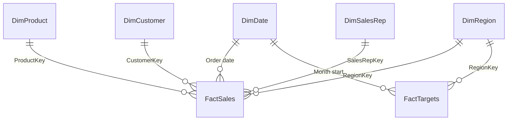

# Data model

Two sources, as in the brief: the ERP's monthly order-line export (three yearly workbooks) and the sales team's target file, plus four small master-data files and the security list. Everything below is generated by `tools/make_data.py` with seed 41 and committed under `data/`; `tests/test_make_data.py` holds the rules and the bands, and `tests/pbi/test_tmdl_lint.py` holds the model.

## Files

CSV files are UTF-8 without BOM, LF line endings, comma-separated, `.` as decimal separator and ISO dates. Every file is at most 2 MB.

| File | Rows | Columns |
|---|---|---|
| `data/sales_orders/sales_orders_2023.xlsx`, `_2024.xlsx`, `_2025.xlsx` | 20,700 / 21,495 / 17,344 order lines | sheet `Orders`: two title rows (`Veltrano Outdoor · Order lines export · 2024`, `ERP export, EUR, net of discount`), the header in row 3: `OrderNumber` (`SO-24-004711`), `OrderLine`, `OrderDate` (Excel date), `CustomerCode` (`C0001`), `SKU` (`TEN-TRK-001`), `SalesRepCode` (`R01`), `Quantity`, `UnitListPriceEUR` (2 dp), `DiscountRate` (fraction, 4 dp), `UnitCostEUR` (2 dp), `NetAmountEUR` (2 dp); sheet `Export info` (period, row count, the fixed export time 2025-10-01 06:00) |
| `data/products.csv` | 180 | `ProductKey`, `SKU`, `ProductName`, `Category`, `CategorySort`, `Subcategory`, `SubcategorySort`, `Brand`, `ListPriceEUR` (2025 list price), `LaunchDate`, `DiscontinuedDate` (empty while active) |
| `data/customers.csv` | 400 | `CustomerKey`, `CustomerCode`, `CustomerName`, `Segment`, `Channel`, `CountryCode`, `Country`, `RegionCode`, `AccountSince` |
| `data/regions.csv` | 5 | `RegionKey`, `RegionCode`, `Region`, `SortOrder` |
| `data/sales_reps.csv` | 12 | `SalesRepKey`, `SalesRepCode`, `SalesRepName`, `Email`, `RegionCode` |
| `data/security.csv` | 5 | `UserEmail`, `RegionCode` (four regional managers; the West manager has two rows, BNL and FRA) |
| `data/targets.csv` | 180 (36 months × 5 regions) | `Month` (`2025-09`), `RegionCode`, `TargetRevenueEUR` (whole EUR, multiples of 1,000) |

`NetAmountEUR` is in the export, so Power BI and Python add up the same rounded cents and never round differently.

## Model

The model lives in `pbip/SalesPerformance.SemanticModel/definition/` (TMDL): culture en-US, `discourageImplicitMeasures` (required by the calculation group), auto date/time off, compatibility level 1606. Hidden columns are marked h.

| Table | Grain and source | Columns |
|---|---|---|
| `FactSales` | order line; the three workbooks combined with `Folder.Files(DataFolder & "sales_orders")` | `Order number`, `Order line` h, `Order date`, `ProductKey` h, `CustomerKey` h, `RegionKey` h (the customer's region), `SalesRepKey` h, `Quantity` h, `Unit list price` h, `Discount rate` h, `Unit cost` h, `Gross amount` h (Quantity × Unit list price), `Net amount` h, `Cost amount` h (Quantity × Unit cost) |
| `FactTargets` | region × month; `targets.csv` | `Month start` h, `RegionKey` h, `Target revenue` h |
| `DimDate` | day from `StartDate` to `EndDate`, built in Power Query; marked as date table on `Date` | `Date`, `Year`, `Quarter` (`Q3`, sorted by `Quarter number` h), `Month`, `Month name` (`Sep`, sorted by `Month`), `Month start`, `Year-month` (`2025-09`, sorted by `Month index`), `Month index` h (2023-01 = 1 to 2025-12 = 36), `Is past` h (calculated: `DimDate[Date] <= MAX(FactSales[Order date])`); hierarchy `Calendar` Year → Quarter → Month name |
| `DimProduct` | product; `products.csv` | `ProductKey` h, `SKU`, `Product`, `Category` (sorted by `Category sort` h), `Subcategory` (sorted by `Subcategory sort` h), `Brand`, `List price`, `Launch date`, `Discontinued date`, `Status` (`Active` or `Discontinued`); hierarchy `Products` Category → Subcategory → Product |
| `DimCustomer` | customer; `customers.csv` | `CustomerKey` h, `Customer code`, `Customer`, `Segment` (sorted by `Segment sort` h: Independent, Chain, Online), `Channel`, `Country code`, `Country`, `RegionKey` h (row-level security only), `Account since` |
| `DimRegion` | region; `regions.csv` | `RegionKey` h, `Region code`, `Region` (sorted by `Region sort` h: DACH, Benelux, Nordics, France, Iberia) |
| `DimSalesRep` | rep; `sales_reps.csv` | `SalesRepKey` h, `Sales rep code`, `Sales rep`, `E-mail`, `Home region`, `RegionKey` h (row-level security only) |
| `Security` | user × region; `security.csv`; hidden, no relationship | `User e-mail`, `RegionKey` |
| `_Measures` | the 22 measures ([measures](measures.md)); one hidden anchor column | `Anchor` h |
| `Time intelligence` | calculation group, precedence 10 | `Time calculation` (sorted by `Ordinal` h) |
| `Analyse by` | field parameter | `Analyse by`, `Analyse by Fields` h, `Analyse by Order` h |

Relationships, all many-to-one with single-direction filtering:

| From | To |
|---|---|
| `FactSales[Order date]` | `DimDate[Date]` |
| `FactSales[ProductKey]` | `DimProduct[ProductKey]` |
| `FactSales[CustomerKey]` | `DimCustomer[CustomerKey]` |
| `FactSales[RegionKey]` | `DimRegion[RegionKey]` |
| `FactSales[SalesRepKey]` | `DimSalesRep[SalesRepKey]` |
| `FactTargets[Month start]` | `DimDate[Date]` |
| `FactTargets[RegionKey]` | `DimRegion[RegionKey]` |

`DimCustomer` and `DimSalesRep` carry `RegionKey` without a relationship: a second path from a region to `FactSales` would be ambiguous. The role `Regional manager` filters them by that column, so other regions' names stay out of slicers and tables.

## Power Query

Parameters: `DataFolder` (text, default `E:\GITGUB\sales-performance-dashboard\data\` with the trailing backslash; set it to the clone's `data` folder), `StartDate` = 2023-01-01 and `EndDate` = 2025-12-31. Every partition reads its file through `DataFolder`.

- `FactSales`: `Folder.Files` on `sales_orders`, only `sales_orders_*.xlsx`, sorted by name; per workbook the sheet `Orders`, the two title rows skipped and the header promoted; the three tables combined.
- Every type conversion passes the culture `en-US`, so a Desktop with German regional settings still reads `.` decimals. Amounts use `Currency.Type` (fixed decimal), so sums are exact.
- The codes of the export become integer keys by `Table.NestedJoin` on `CustomerCode` (which also brings the customer's `RegionKey`), `SKU` and `SalesRepCode`. `tests/test_make_data.py` checks that every code resolves, so no key is ever blank.
- `DimDate` is a list of days from `StartDate` to `EndDate`; `Month index` is (Year − year of `StartDate`) × 12 + Month, which is why `StartDate` must be a 1 January (`tests/pbi/test_tmdl_lint.py`).

## Generator

`uv run python tools/make_data.py [--out data] [--check]`. Seed 41 for `numpy.random.default_rng`; Faker (pinned by `uv.lock`) draws the 16 person names with its own seed `NAME_SEED` (42). `--check` regenerates into a temporary folder and compares the CSV files byte for byte and the workbooks by sheet names and cell values (zip entry times differ between runs, so the workbooks carry the fixed time 2025-10-01 06:00 in their properties).

- Calendar: orders Monday to Friday from 2023-01-02 to 2025-09-30, no holiday calendar, with at least one order on the first and the last business day. The simulation runs to December 2025 for the targets.
- Geography: DACH (AT, DE, CH), Benelux (NL, BE, LU), Nordics (SE, NO, DK, FI), France (FR), Iberia (ES, PT).
- Customers (400): DACH 160 (AT 55, DE 85, CH 20), Benelux 60 (NL 30, BE 25, LU 5), Nordics 60 (SE 22, NO 15, DK 13, FI 10), France 72, Iberia 48 (ES 34, PT 14). Segments Independent 260, Chain 40 (DACH 16, Benelux 6, Nordics 6, France 8, Iberia 4), Online 100, the rest pro rata. The channel is an attribute of the account (a distribution partner serves whole accounts): the share of Direct accounts is 0.95 in DACH, 0.80 in Benelux, 0.70 in France, 0.30 in the Nordics and 0.25 in Iberia, the rest buy through a Distributor. 360 accounts exist from January 2023; 40 join evenly from April 2023 to June 2025. Names are an invented two-syllable stem plus `Outdoor`, `Bergsport` or `Trail Shop` (Independent), `Sport Group` (Chain) or `Online` (Online).
- People: 12 reps (DACH 4, Benelux 2, Nordics 2, France 2, Iberia 2) and 4 regional managers (DACH; West for Benelux and France; Nordics; Iberia) with names from Faker in the region's locale (de_AT, nl_NL, sv_SE, fr_FR, es_ES) and the address `first.last@veltrano.example`, folded to ASCII. Each customer has one account rep of its region, assigned round robin.
- Products (180, 30 per category, 19 subcategories): three brands carry the company name, Veltrano Summit (premium, 25 % of the products, price × 1.25, cost ratio − 0.03), Veltrano Trail (45 %, × 1.00) and Veltrano Camp (value, 30 %, × 0.80, cost ratio + 0.04). The 2023 list price is uniform in the subcategory's band; the cost ratio is the category's (Tents 0.62, Sleeping 0.59, Backpacks 0.57, Apparel 0.52, Footwear 0.64, Cooking 0.54) ± 0.03 per product. Every 1 January list prices rise 3.0 % and costs 3.5 %. 20 products launch between February 2024 and April 2025; 12 are discontinued between June 2024 and March 2025.
- Orders: per customer and month a Poisson count with a base rate per segment, times the mix-weighted seasonal index, a yearly trend and one global factor that sets the expected line count to 60,000. Lines per order 1 + Poisson (Independent 2.5, Chain 4.5, Online 3.0), at most 12, distinct SKUs. The category of a line is drawn by its base share (Tents 0.12, Sleeping 0.14, Backpacks 0.15, Apparel 0.28, Footwear 0.15, Cooking 0.16) times the category's index of the month; the product by a lognormal(0, 1.0) popularity among the products active on the date. Quantity 1 + Poisson(mean − 1) with the mean Tents 2, Sleeping 3, Backpacks 3, Apparel 5, Footwear 4, Cooking 6, times Independent 1.0, Online 1.5 and Chain 2.5.
- Seasonality, January to December, mean 1: summer categories (Tents, Sleeping, Backpacks, Cooking) 0.55 0.80 1.20 1.45 1.55 1.35 1.00 0.80 0.75 0.70 0.70 0.55; Apparel 0.70 0.85 1.05 1.05 0.90 0.75 0.85 1.15 1.40 1.35 1.10 0.70; Footwear 0.70 0.90 1.20 1.30 1.30 1.10 0.95 0.90 1.00 0.95 0.80 0.60. The Nordics run one month later, Iberia one month earlier.
- Discount: Independent 5 %, Online 8 %, Chain 12 %; Distributor + 6 pp; quantity of 24 or more + 3 pp; clearance + 10 pp on 15 % of the lines in August and September (summer categories and Footwear) and in January and February (Apparel); + 15 pp in a discontinued product's last two months; noise normal(0, 1.5 pp); clipped to 0–35 %; four decimals. `NetAmountEUR` = Quantity × UnitListPriceEUR × (1 − DiscountRate), rounded half up to the cent with `Decimal`.
- Targets: per region and month the mean revenue of 20 further runs (seeds 1041 to 1060) times the region's ambition (DACH 1.00, Benelux 1.02, France 0.98, Nordics 1.08, Iberia 1.04), rounded to EUR 1,000.

### Generator tuning

The generator rules allow tuning the rates and quantity means, never the bands. Two values differ from the first draft of the rules:

| Constant in `tools/make_data.py` | Draft | Used | Why |
|---|---|---|---|
| `TREND_PER_YEAR` | + 1.5 % | − 1.0 % | list prices already rise 3 % a year and 40 accounts join; with + 1.5 % on top, no nearby set of rates kept both growth bands |
| `ORDER_RATE` (Independent, Chain, Online) | 0.9, 2.2, 1.4 | 0.85, 2.2, 1.35 | with the draft rates, seed 41 missed a growth band or the attainment band; a small search over the rates took the first set at which every band holds |

`NAME_SEED` (42) seeds Faker and changes names and e-mail addresses only, never a number: if a generated person name ever collides with a term the repository must not contain, raise it by one and regenerate.

Bands that `tests/test_make_data.py` holds, with the values of the committed files:

| Band | Holds | Committed files |
|---|---|---|
| order lines | 58,000–62,000 | 59,539 |
| orders | 13,000–16,500 | 14,693 |
| customers with orders | at least 395 | 400 |
| revenue 2023 | EUR 10.5–14.0 m | EUR 11.27 m |
| 2024 vs 2023 | + 6 to + 10 % | + 8.2 % |
| Jan–Sep 2025 vs Jan–Sep 2024 | + 6 to + 10 % | + 6.6 % |
| gross margin % per year, 2025 below 2023 | 30–38 % | 35.7 %, 35.3 %, 34.7 % |
| discount % | 8–13 % | 11.5 % |
| average order value | EUR 1,900–3,200 | EUR 2,295 |
| Tents peak month | April or May | May 2023, May 2024 |
| Apparel peak month | September or October | October 2023, September 2024 |
| share of the top 36 products (20 %) in 2024 revenue | 0.50–0.70 | 0.630 |
| DACH in 2024 | 38–48 % of revenue | 40.9 % |
| 2024 attainment per region | within ± 4 pp of 1 / ambition | DACH − 2.1, Benelux + 1.7, Nordics + 0.9, France + 1.1, Iberia − 2.2 pp |
